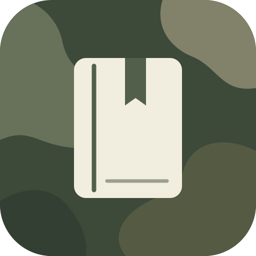
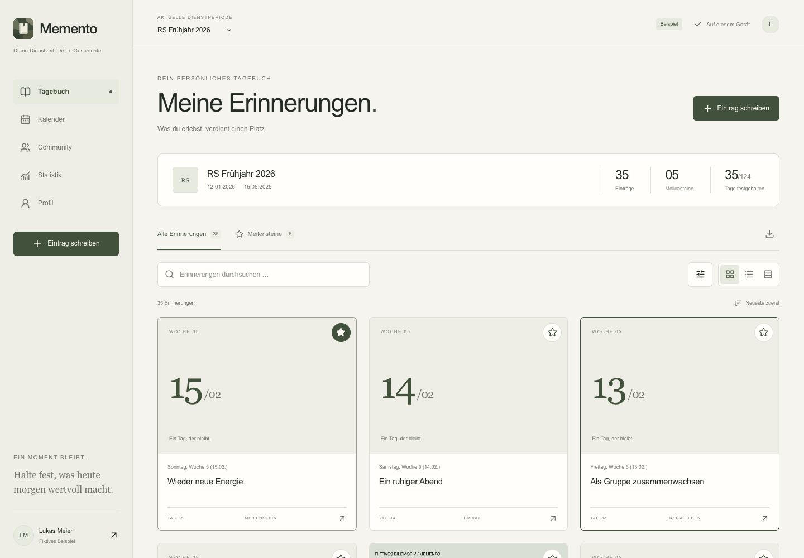
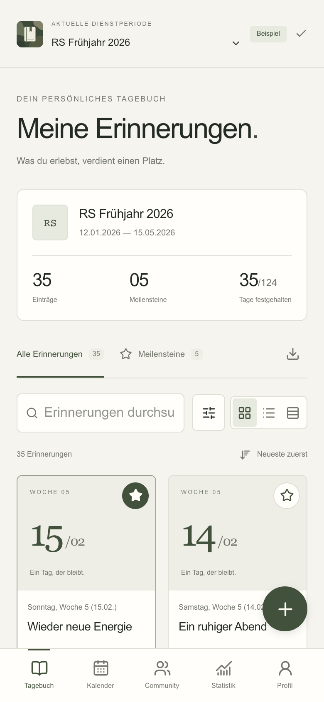
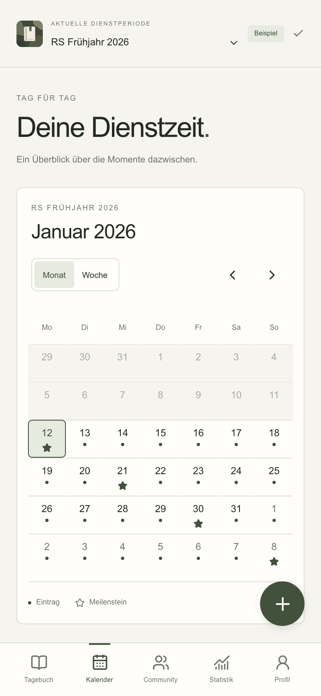
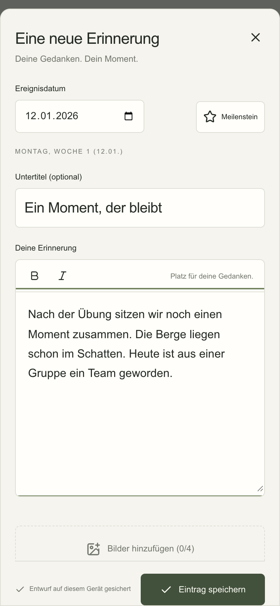
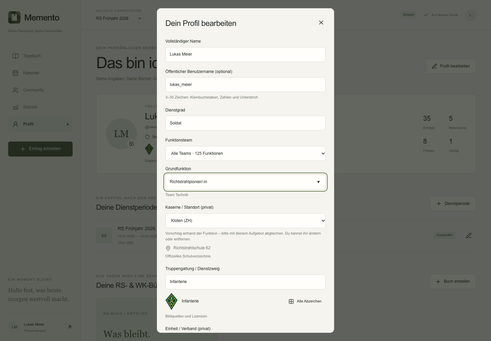
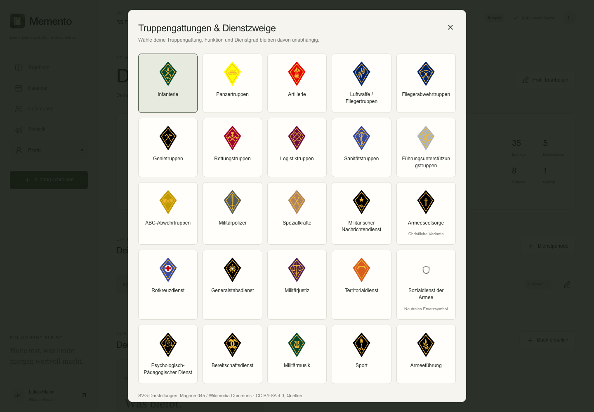
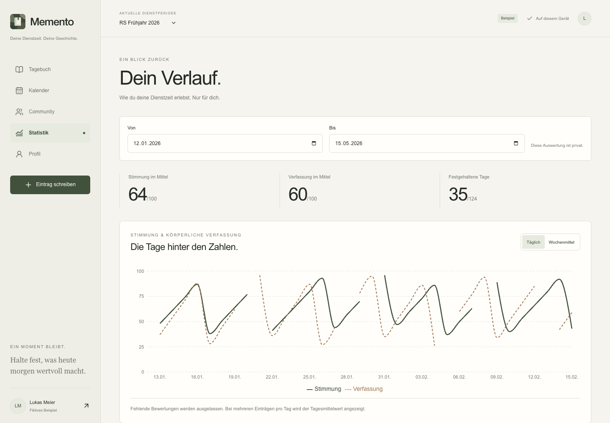
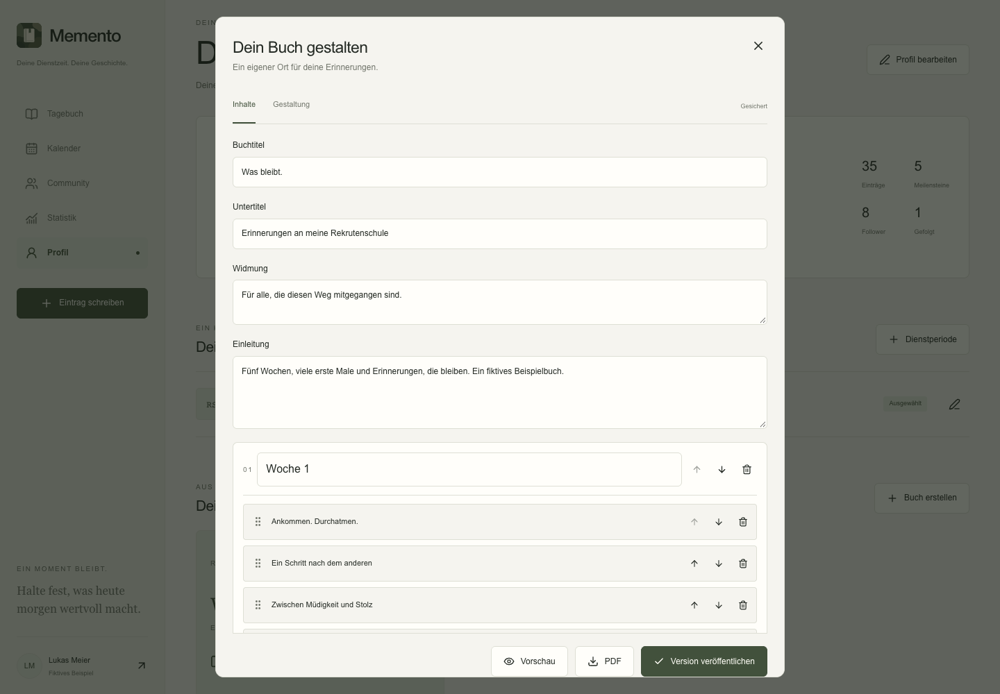
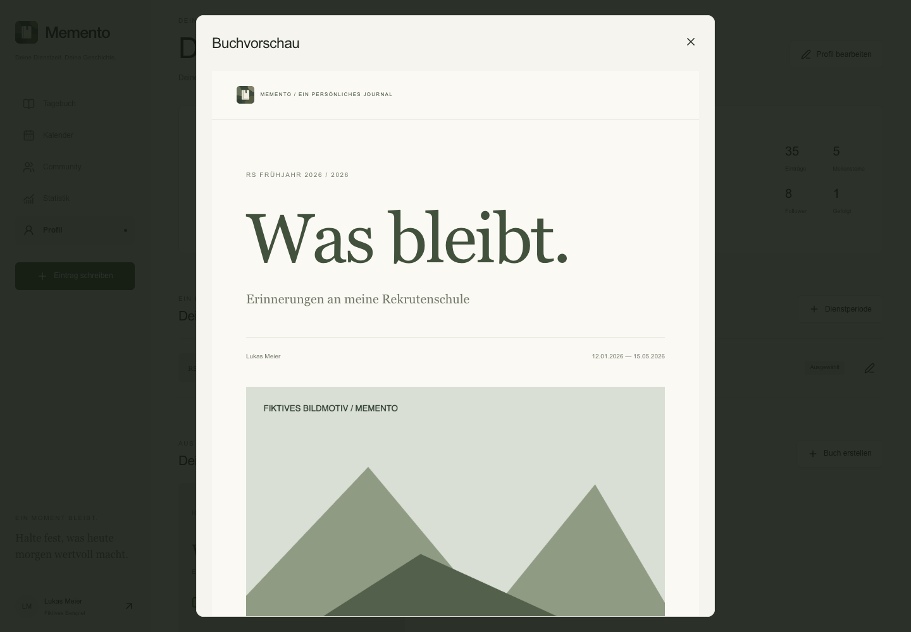

<p align="center">
  
</p>

<h1 align="center">Memento</h1>
<p align="center"><strong>Deine Dienstzeit. Deine Geschichte.</strong></p>
<p align="center">Ein persönliches Militärtagebuch für RS, WK und die Erinnerungen dazwischen.</p>



Memento hält Texte, Fotos und besondere Momente deiner Dienstzeit fest. Aus einzelnen
Tagen entstehen ein durchsuchbares Tagebuch und ein eigenes RS- oder WK-Buch.
Die Oberfläche ist für Smartphones gestaltet und passt sich bis zum Desktop an.

Die App funktioniert **ohne Cloudkonto als lokales Tagebuch**. Mit einem eigenen
Supabase-Projekt kommen Anmeldung, Synchronisation, Community und Freigabelinks hinzu.
Neue Notizbücher starten leer. Ein fiktives Beispiel lässt sich ausdrücklich auswählen.

## Ein Blick in die App

<table>
  <tr>
    <th>Tagebuch</th>
    <th>Kalender</th>
    <th>Eintrag schreiben</th>
  </tr>
  <tr>
    <td></td>
    <td></td>
    <td></td>
  </tr>
</table>

Alle Screenshots stammen aus der laufenden App. Namen, Dienstangaben, Texte und
Bildmotive in der Beispielansicht sind fiktiv.

## Was Memento kann

| Bereich                  | Funktionen                                                                                                                                                                  |
| ------------------------ | --------------------------------------------------------------------------------------------------------------------------------------------------------------------------- |
| **Tagebuch**             | Einträge erstellen und bearbeiten, bis zu vier Fotos, Meilensteine, Volltextsuche, Filter sowie Listen-, Karten- und Timeline-Ansicht.                                      |
| **Militärprofil**        | 125 Funktionen in vier Teams, durchsuchbare Auswahl, 29 Kasernen mit änderbaren Vorschlägen und eine Galerie mit 24 lokal gespeicherten Truppensymbolen.                    |
| **Dienstperioden**       | Mehrere RS-, WK- und weitere Perioden mit eigenen Datums- und Militärangaben; Monats- und Wochenkalender.                                                                   |
| **Persönlicher Verlauf** | Freiwillige Angaben zu Stimmung und körperlicher Verfassung von 0 bis 100, Tages- und Wochenmittel, Zeitraumfilter. Diese Werte bleiben privat.                             |
| **Offline**              | Lokale Speicherung mit IndexedDB, wiederherstellbare Entwürfe und PWA. Im Cloudmodus werden ausstehende Änderungen gespeichert und bei Verbindung synchronisiert.           |
| **Erinnerungsbücher**    | Tagebucheinträge übernehmen, Kapitel, Texte und Galerien ergänzen, Abschnitte sortieren und drei Gestaltungsvorlagen nutzen. Veröffentlichte Versionen bleiben unverändert. |
| **Export und Backup**    | PDF in A4, A5 oder quadratisch; JSON-/ZIP-Backups mit Importvorschau, Zusammenführen oder Wiederherstellung.                                                                |
| **Community**            | Mit Supabase: Personen suchen, Follow-Anfragen bestätigen, einen Feed lesen und Personen blockieren.                                                                        |
| **Freigaben**            | Mit Supabase: getrennte Tagebuch- und Buchlinks mit optionalem Passwort, Ablaufdatum und Widerruf.                                                                          |
| **Darstellung**          | Heller, dunkler oder systemabhängiger Modus, dezente Akzentfarben und ein eigenes Memento-Logo mit PWA-Icons.                                                               |

### Funktion, Kaserne und Truppengattung

Die Funktionssuche lässt sich auf die vier Teams einschränken. Bei Wahl einer Funktion
wird eine passende Kaserne vorgeschlagen; mehrere Standorte bleiben auswählbar.
Profil und Dienstperioden speichern ihre Angaben getrennt und privat. Die Galerie
zeigt die lokal eingebundenen Truppensymbole; der Sozialdienst hat ein gekennzeichnetes
Ersatzsymbol. [Quellen und Zuordnungsregeln](docs/MILITARY_CATALOG.md).

<details>
  <summary>Funktionsauswahl und Abzeichengalerie ansehen</summary>





</details>

### Den eigenen Verlauf verstehen

Die Statistik wertet deine tatsächlichen Einträge aus. Stimmung und körperliche
Verfassung sind voneinander unabhängig und können beim Schreiben ausgelassen werden.
Sie erscheinen weder im öffentlichen Leser noch im PDF.



### Aus Tagen wird ein Buch

Im Profil lässt sich aus einer Dienstperiode ein Buch erstellen. Cover, Titel,
Widmung, Kapitel und Reihenfolge sind bearbeitbar. Die Vorschau zeigt den Lesemodus;
eine veröffentlichte Version bewahrt den damaligen Stand für Archiv und Export.



<details>
  <summary>Lesemodus ansehen</summary>



</details>

## Lokal starten

Voraussetzungen: **Node.js 22 oder neuer** und npm.

```sh
git clone https://github.com/bien187/Memento.git
cd Memento
npm ci
cp .env.example .env.local
npm run dev
```

Öffne [localhost:3000](http://localhost:3000).

1. **Lokales Tagebuch öffnen** wählen und das Profil einrichten – oder das ausdrücklich
   fiktive Beispiel zum Erkunden öffnen.
2. Eine Dienstperiode mit Start- und Enddatum anlegen.
3. Erinnerungen schreiben, Fotos ergänzen und besondere Tage als Meilenstein markieren.
4. Im Profil ein RS-/WK-Buch erstellen oder die Daten als PDF beziehungsweise ZIP sichern.

Für den lokalen Modus dürfen die Supabase-Felder in `.env.local` leer bleiben.
Lokale Daten gehören zu diesem Browser und Gerät. Ein ZIP-Backup ermöglicht die
Übertragung; Browserdaten löschen entfernt auch das lokale Tagebuch.

### Produktionsmodus und PWA

```sh
npm run build
npm run start
```

Die Offline-App am Produktionsbuild prüfen: einmal online öffnen und danach offline
neu laden. Für eine Installation ausserhalb von `localhost` ist HTTPS erforderlich.
Erinnerungen werden bei geöffneter App verarbeitet; zeitgenaue Hintergrund-Pushs sind
nicht implementiert.

## Cloudfunktionen einrichten

Der Quellcode für Supabase ist enthalten. Ein externes Projekt oder Hosting wird
durch das Klonen des Repositorys nicht automatisch eingerichtet.

1. Eigenes Supabase-Projekt erstellen und die Migrationen aus
   [`supabase/migrations`](supabase/migrations) anwenden.
2. Die Katalogdaten aus [`supabase/seed.sql`](supabase/seed.sql) importieren.
3. URL und Publishable Key in `.env.local` eintragen. Den Service-Role-Key nur
   serverseitig als `SUPABASE_SERVICE_ROLE_KEY` setzen.
4. Auth-URLs, E-Mail-Versand und bei Bedarf Google beziehungsweise Apple konfigurieren.
5. Für Hosting beispielsweise Vercel verwenden und `NEXT_PUBLIC_SITE_URL` auf die
   eigene HTTPS-Domain setzen.

Die genaue Reihenfolge, Befehle, Provider-Konfiguration und Testdaten stehen in
**[DEPLOYMENT.md](DEPLOYMENT.md)**. Alle benötigten Variablen sind in
[`.env.example`](.env.example) aufgeführt. Zugangsdaten gehören nicht ins Repository.

Im lokalen Modus sind Community und öffentliche Freigaben nicht verfügbar. Die
Beispielansicht kennzeichnet simulierte Inhalte. Echte Supabase-, OAuth- und
Hosting-Verbindungen benötigen nach der Einrichtung eine eigene Live-Abnahme.

## Technik

| Ebene               | Umsetzung                                                                |
| ------------------- | ------------------------------------------------------------------------ |
| App                 | Next.js App Router, React, TypeScript strict                             |
| Oberfläche          | Tailwind CSS, Radix UI, Lucide, Motion                                   |
| Formulare und Daten | React Hook Form, Zod, TanStack Query                                     |
| Lokale Daten        | Dexie / IndexedDB, Entwürfe und dauerhafte Synchronisationswarteschlange |
| Backend             | Supabase Auth, PostgreSQL mit Row Level Security, privater Storage       |
| Bücher und Export   | dnd-kit, jsPDF, JSZip                                                    |
| Prüfungen           | Vitest, PGlite und Playwright                                            |

```text
src/app/              Seiten, Auth-Callback und Server-Endpunkte
src/components/       Tagebuch, Kalender, Bücher, Profil und Community
src/lib/domain/       Datenmodell, Datumslogik, Kataloge und Auswertungen
src/lib/local/        IndexedDB, Synchronisation und Medienverarbeitung
src/lib/server/       Geschützte Freigaben
supabase/             Migrationen, RLS, RPCs und Katalogdaten
public/               Logo, App-Icons, Manifest und Service Worker
tests/                Fach-, Datenbank- und Sicherheitstests
e2e/                  Browserabläufe auf Smartphone und Desktop
docs/screenshots/     Echte Aufnahmen für diese README
```

Technische Datenbank-, Backup- und Paketbezeichner aus der frühen Entwicklung
bleiben aus Kompatibilitätsgründen teilweise bei `feldbuch`. Der sichtbare App-Name
ist **Memento**.

## Tests

```sh
npm run typecheck
npm test
npm run build
npm run test:e2e
```

Lokale Abnahme am **23.10.2026**: Typecheck und Produktionsbuild erfolgreich,
**38 Vitest-Tests** sowie **20 Playwright-Tests** erfolgreich. Die Browserabläufe
prüfen unter anderem leere neue Notizbücher, Entwürfe, Offline-Neuladen, Bildgrenzen,
Bücher, PDF und Backupimport auf Smartphone und Desktop.

Playwright verwendet standardmässig lokal installiertes Google Chrome und startet
einen Produktionsserver auf Port 3100. PostgreSQL-Tests laufen ohne Docker mit
PGlite. Supabase Auth und Storage sind dabei durch Schema-Stubs abgebildet; das
ersetzt keinen Test der externen Dienste. Details: [TESTING.md](TESTING.md).

### Screenshots neu aufnehmen

In einem Terminal einen Produktionsserver starten:

```sh
npm run build
npm run start -- --port 3200
```

In einem zweiten Terminal:

```sh
node scripts/capture-readme-screenshots.mjs
```

Das Skript öffnet Chrome mit einem frischen Browserprofil, wählt das fiktive Beispiel
und speichert die neun Aufnahmen in `docs/screenshots`. Ein anderer laufender Server
kann über `MEMENTO_SCREENSHOT_URL` angegeben werden.

Mehr zu Funktionen, Standortzuordnung und Bildquellen: [Militärkatalog](docs/MILITARY_CATALOG.md).

## Weitere Dokumentation

| Dokument                                             | Inhalt                                               |
| ---------------------------------------------------- | ---------------------------------------------------- |
| [ARCHITECTURE.md](ARCHITECTURE.md)                   | Architektur und Aufbau                               |
| [DATABASE.md](DATABASE.md)                           | Tabellen, Zugriffsregeln und Backupformat            |
| [SECURITY.md](SECURITY.md)                           | Synchronisation, Freigaben und private Medien        |
| [DESIGN_SYSTEM.md](DESIGN_SYSTEM.md)                 | Farben, Typografie und Komponenten                   |
| [BRANDING.md](BRANDING.md)                           | Memento-Logo, Iconvarianten und Erzeugung der Assets |
| [DEPLOYMENT.md](DEPLOYMENT.md)                       | Supabase, OAuth, Testdaten und Hosting               |
| [TESTING.md](TESTING.md)                             | Automatische Prüfungen und externe Abnahme           |
| [IMPLEMENTATION_STATUS.md](IMPLEMENTATION_STATUS.md) | Implementierungsstand und bekannte Grenzen           |

Memento ist ein unabhängiges Projekt ohne Verbindung zur Schweizer Armee oder
Armeekompass. Die Beispielbilder sind selbst gezeichnete, fiktive Motive. Hinweise
und Lizenztexte zu verwendeten Open-Source-Paketen liegen unter
[`public/licenses`](public/licenses). Die Truppensymbole besitzen eigene
[Quellen- und Lizenznachweise](public/insignia/NOTICE.txt).
